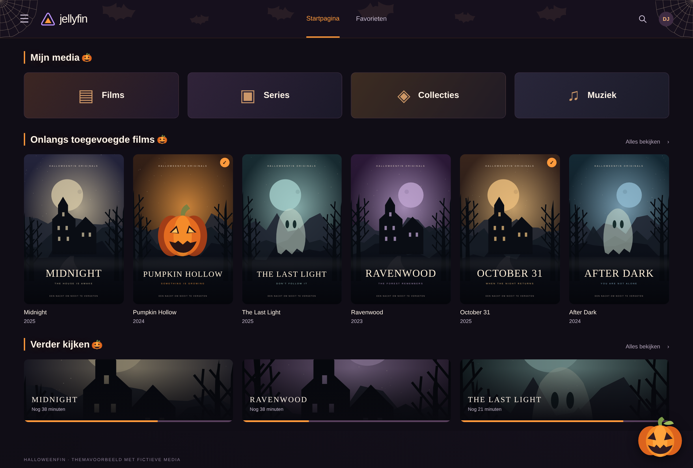

# 🎃 Halloweenfin
### Pumpkin & Midnight — een Halloween-thema voor Jellyfin

Geef je filmavond een Halloween-sfeer met een donkere achtergrond, warme oranje accenten en zachte paarstinten. Pompoenen, spinnenwebben en vleermuizen maken je bibliotheek klaar voor het griezelseizoen.

**Eén CSS-bestand · Geen plugins nodig · Ingebouwde SVG-decoraties**

## 📸 Voorbeeld



*Themavoorbeeld met de originele Halloweenfin-CSS en fictieve media; geen opname van een live Jellyfin-server.*

## ✨ Wat zit erin?

- **Donkere uitstraling** met een subtiele, warme gloed.
- **Halloween-decoraties:** spinnenwebben en vleermuizen in de header, pompoenen bij sectietitels en rechtsonder.
- **Posters met een spinnenoverlay** wanneer je er met de muis overheen gaat.
- **Bijpassende bediening:** oranje knoppen, voortgangsbalken en accenten.
- **Gestylede webvideospeler** met transparante bedieningsbalken.
- **Aanpassingen voor kleinere schermen** en zichtbare toetsenbordfocus.

De decoraties worden bij herkende videospelerweergaven verborgen, zodat je film de aandacht krijgt. Alle illustraties zitten in het CSS-bestand; er worden geen losse afbeeldingen of lettertypen geladen.

## 🚀 Installeren

Je hebt een Jellyfin-beheerdersaccount nodig om de CSS op de server in te stellen. De namen van de menu's kunnen per taal of versie iets verschillen.

### Optie 1 — Installeren met één regel

1. Open je Jellyfin-server in de browser en log in als beheerder.
2. Ga naar **Dashboard → Branding**.
3. Zoek het veld **Custom CSS / Aangepaste CSS**.
4. Maak een kopie van eventuele bestaande CSS. Verwijder andere thema's uit het veld om conflicten te voorkomen.
5. Plak deze regel **helemaal bovenaan** het CSS-veld:

```css
@import url("https://cdn.jsdelivr.net/gh/DJRetard/Halloweenfin@main/halloween.css");
```

6. Klik op **Opslaan / Save** en vernieuw de pagina.

> Deze methode haalt het thema op via jsDelivr. Je browser moet dit adres kunnen bereiken. Wijzigingen op de `main`-branch worden na het verversen van caches beschikbaar; ze verschijnen daardoor niet altijd direct.

### Optie 2 — Handmatig kopiëren

Wil je de CSS rechtstreeks in Jellyfin opslaan, zonder een externe stylesheet te laden?

1. Open [halloween.css als platte tekst](https://raw.githubusercontent.com/DJRetard/Halloweenfin/main/halloween.css).
2. Kopieer de **volledige inhoud** van het bestand.
3. Ga in Jellyfin naar **Dashboard → Branding → Custom CSS / Aangepaste CSS**.
4. Bewaar eventuele bestaande CSS apart en vervang het thema in het veld door de gekopieerde inhoud.
5. Klik op **Opslaan / Save** en vernieuw de pagina.

Gebruik één van deze twee methoden. Je hoeft geen bestanden in je Jellyfin-installatie of Docker-container te wijzigen.

## 🔄 Bijwerken

**Met de importregel:** vernieuw Jellyfin om de beschikbare versie op te halen. Houd rekening met browser- en CDN-caching. Wil je een wijziging meteen gebruiken, kies dan de handmatige methode.

**Handmatig geïnstalleerd:** kopieer de nieuwste inhoud van [halloween.css](https://github.com/DJRetard/Halloweenfin/blob/main/halloween.css), vervang de oude thema-CSS en sla opnieuw op.

## 🧹 Verwijderen

Ga naar **Dashboard → Branding → Custom CSS / Aangepaste CSS**, verwijder de importregel of de geplakte Halloweenfin-CSS en sla op. Herstel eventueel je eerder bewaarde CSS en vernieuw de pagina.

## 🛠️ Zie je het thema niet?

- Controleer of je de wijzigingen hebt opgeslagen.
- Vernieuw zonder cache: **Ctrl + F5** op Windows/Linux of **Cmd + Shift + R** op macOS.
- Test in de browser via de webinterface van je eigen Jellyfin-server.
- Controleer bij de importmethode of je browser of netwerk `cdn.jsdelivr.net` blokkeert. Probeer dan handmatig kopiëren.
- Verwijder tijdelijk andere thema's of CSS-regels als onderdelen er anders uitzien dan verwacht.
- Als je client een instelling heeft om aangepaste server-CSS uit te schakelen, controleer dan of die het thema niet blokkeert.

## 🌐 Compatibiliteit

Halloweenfin is gemaakt voor **Jellyfin Web**. Apps die de webinterface gebruiken kunnen het thema overnemen; native mobiele en tv-apps met een eigen interface doen dat doorgaans niet.

Gebruik een recente browser. Het thema gebruikt moderne CSS, waaronder `:has()`; in oudere browsers kunnen onderdelen of het verbergen van decoraties anders werken.

De weergave hangt af van je Jellyfin Web-versie, client en andere aangepaste CSS. Er is nog geen geverifieerde lijst met geteste versies. De vermelding van versie 12.2 in het CSS-bestand is geen bevestiging dat die versie is getest.

## 🐛 Probleem melden

Maak een [issue aan](https://github.com/DJRetard/Halloweenfin/issues) met je Jellyfin-serverversie, de Web-/clientversie, browser, installatiemethode en eventueel een screenshot. Daarmee is een weergaveprobleem makkelijker te onderzoeken.

---

🍂 **Lichten uit, pompoenen aan. Veel kijkplezier!**

## 🤖 Gemaakt met AI

Dit project is volledig met AI gemaakt: het thema, de CSS-code, de README en het themavoorbeeld met fictieve filmposters.
